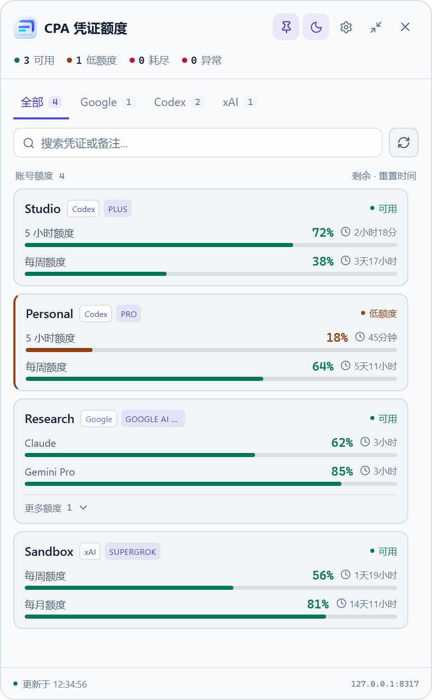
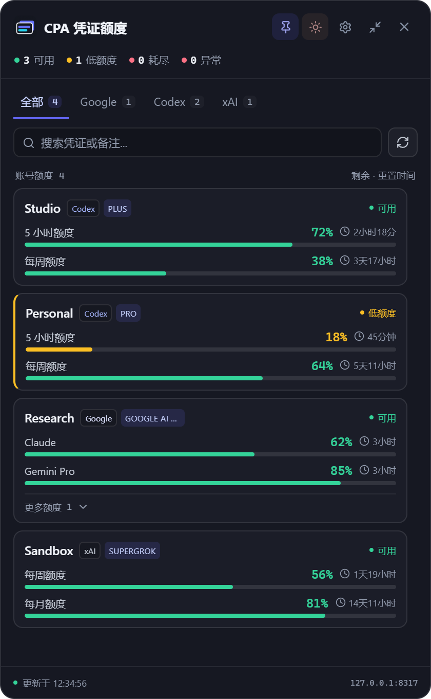
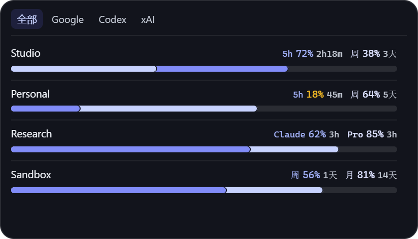
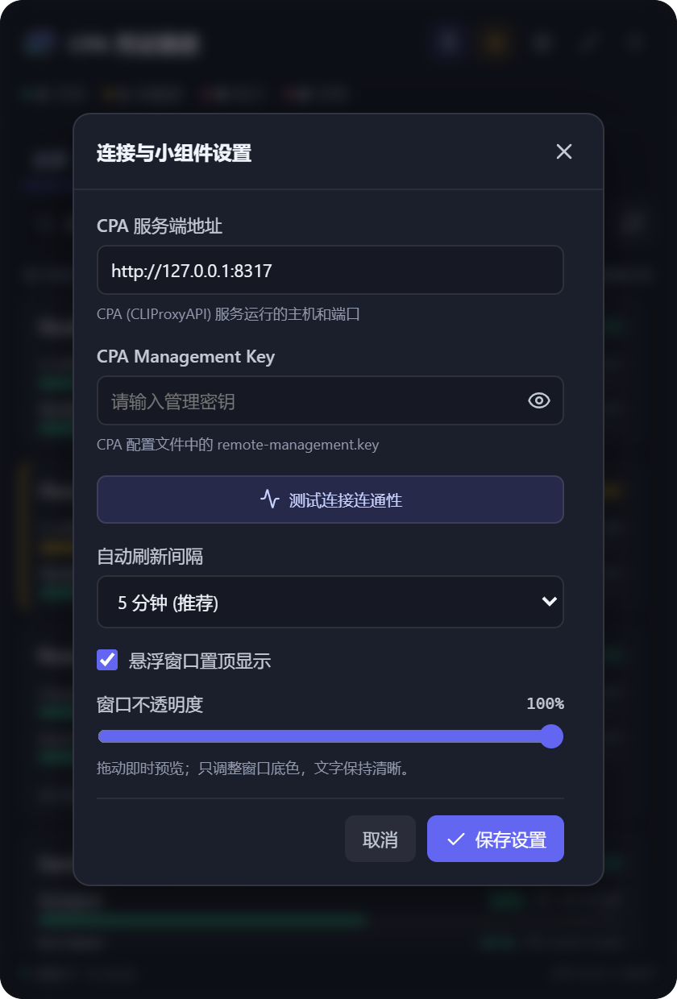

<div align="center">


# CPA 额度悬浮卡片 (CPA Quota Widget)

[](https://github.com/CarryDream/cpa-quota-widget/releases/latest)
[](LICENSE)
[](https://github.com/CarryDream/cpa-quota-widget/stargazers)

面向 **CPA (CLIProxyAPI)** 与 **CPAMP (CPA Manager Plus)** 的轻量跨平台桌面额度卡片与抬头显示小组件。

无需一直打开 Web 网页面板，在桌面即可实时掌握各平台的账号配额百分比、重置倒计时与健康状态。

[中文文档](README_CN.md) ｜ [English](README.md) ｜ [下载发布版本](https://github.com/CarryDream/cpa-quota-widget/releases)

</div>

---

## 界面预览

<div align="center">

| 白天模式（展开） | 夜间模式（展开） |
| :---: | :---: |
|  |  |

| 迷你悬浮胶囊 | 窗口内设置层 |
| :---: | :---: |
|  |  |

*截图采用虚构演示数据展示，不含任何真实账号信息。*

</div>

---

## 核心功能

- **多平台额度监控**：支持 Google、Codex/OpenAI、xAI/Grok、Claude 等平台的 Tab 快捷切换；直观显示 5 小时、每周与每月额度窗口及重置倒计时。
- **智能磁吸吸附（Magnetic Docking）**：窗口拖动时，自动与桌面屏幕边缘（避开任务栏）、以及其他正在运行的应用窗口边缘（VS Code、Chrome、微信等）进行磁吸吸附对齐，轻松靠边停靠或并排排列。
- **自动过滤禁用账号**：CPA 中被标记为停用或禁用的凭证，面板与迷你窗口中自动隐藏，不计入额度统计。
- **一键隐私脱敏显示**：标题栏自带眼睛按钮，支持一键脱敏打码（如 `us***e@gmail.com`、`138****5678`），防止屏幕共享、视频录制或截图时泄露敏感信息。
- **白天/夜间主题同步**：标题栏一键切换日间/夜间模式；窗口 Logo、任务栏图标、系统托盘图标与浏览器 Favicon 均智能同步对应明暗主题。
- **迷你胶囊与展开模式**：双击即可在极简迷你条（同一刻度深浅双层进度条对比）与完整卡片视图之间快速切换。
- **窗口置顶与透明度调节**：支持将卡片固定在所有窗口最前端；可在设置中实时预览并调节窗口不透明度。
- **系统托盘集成**：点击右上角关闭按钮自动隐藏到系统托盘，左键快速显隐，右键菜单支持刷新、配置与彻底退出。

---

## 快速安装与使用

### 方式 1：下载官方发布版本（推荐）

在 [GitHub Releases](https://github.com/CarryDream/cpa-quota-widget/releases) 页面下载适合你系统的安装包：

| 平台 | 格式 | 说明 |
|---|---|---|
| **Windows** | `cpa-quota-widget-*-windows-x64-portable.zip` | **免安装绿色版**（推荐）— 解压后双击即可直接运行 |
| **Windows** | `cpa-quota-widget_*_x64_en-US.msi` / `-setup.exe` | 传统安装包或安装向导 |
| **macOS** | `cpa-quota-widget-*-macOS.zip` / `.dmg` | 支持 Apple Silicon 及 Intel 芯片 |
| **Linux** | `*.AppImage` / `*.deb` | Linux 便携版或 Debian/Ubuntu 安装包 |

---

### 方式 2：从源码编译构建

#### 环境前置要求

1. **Node.js**：`v20` 或 `v22+`
2. **Rust**：Stable 工具链（`rustup default stable`）
3. **平台依赖**：
   - **Windows**: Microsoft C++ Build Tools 与 WebView2 Runtime
   - **macOS**: Xcode Command Line Tools
   - **Linux**: `libwebkit2gtk-4.1-dev`, `libappindicator3-dev`, `librsvg2-dev`

```bash
# 克隆仓库
git clone https://github.com/CarryDream/cpa-quota-widget.git
cd cpa-quota-widget

# 安装前端依赖
npm install

# 启动桌面开发版（支持热重载）
npm run tauri dev

# 打包全套生产二进制与安装包
npm run tauri build
```

编译生成的文件位于 `src-tauri/target/release/` 目录下。

---

## 首次连接配置

打开小组件的**设置**面板（齿轮图标或托盘菜单），配置你的 CPA 服务地址与密钥：

| 连接目标 | 默认服务地址 | 所需密钥 |
|---|---|---|
| **直接连接 CPA (CLIProxyAPI)** | `http://127.0.0.1:8317` | **CPA Management Key**（即 CPA 配置文件中的 `remote-management.key`） |
| **通过 CPAMP 连接** | `http://127.0.0.1:18317` | **CPAMP Admin Key**（即 CPAMP 首次启动在控制台打印的管理员密钥） |

> ⚠️ **注意**：此处**不是模型推理 API Key**（如 `sk-...`）。小组件仅调用 Management API 获取凭证与代理额度。

1. 点击 **“测试连接连通性”** 验证连通性与凭证列表读取。
2. 点击 **“保存连接与偏好”** 保存设置并自动刷新额度数据。

---

## 隐私与安全

- **纯本地存储**：服务配置与密钥仅保存在本地 WebView 的 `localStorage` 中，无任何第三方分析 SDK、遥测或回传。
- **点对点通信**：小组件只与你明确配置的 CPA / CPAMP 实例通信。
- **隐私模式保护**：支持名称脱敏，有效防止屏幕共享或截图时外泄账号标识。

---

## 致谢

- [CLIProxyAPI](https://github.com/router-for-me/CLIProxyAPI) — 优秀的 AI API 代理与路由管理网关。
- [CPA-Manager-Plus](https://github.com/seakee/CPA-Manager-Plus) — CPA 自托管管理与可观测性平台。
- [Tauri](https://tauri.app/) — 现代、轻量、安全的跨平台桌面应用框架。

---

## 开源协议

[MIT](LICENSE) — Copyright (c) 2026 CarryDream.
